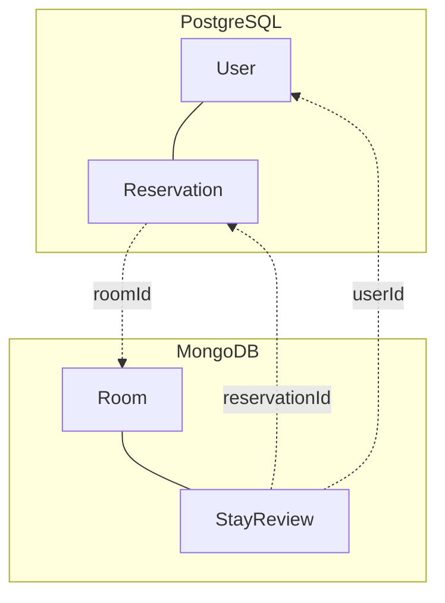
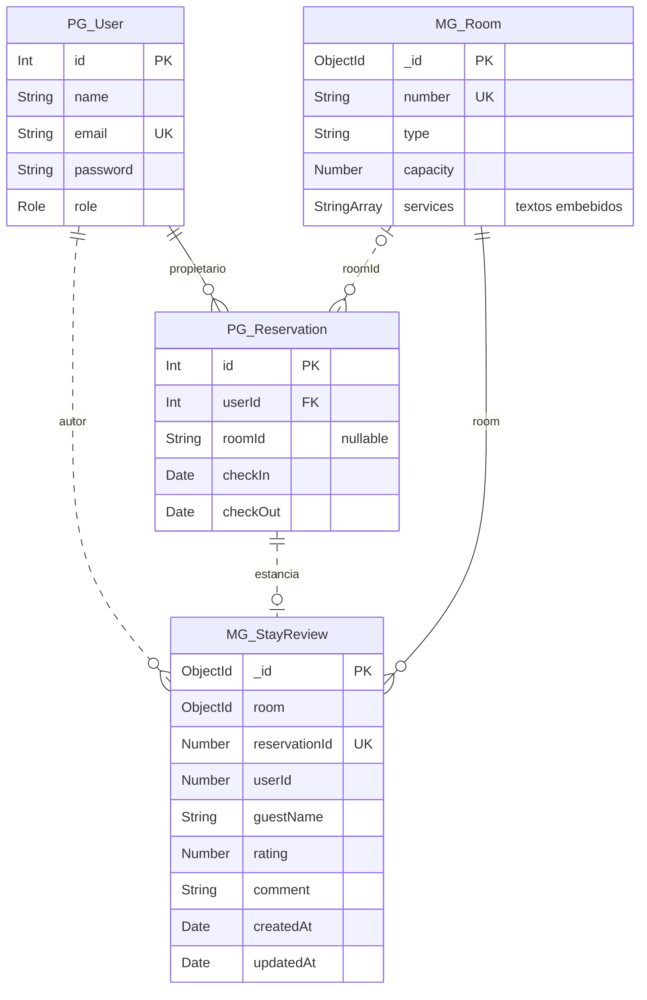

# Modelo híbrido del Hotel
Patricio Rojs · Lista 3 · Caso 3

## 1. Workload
### 1.1 Casos de uso
Un visitante compara habitaciones y opiniones. El huésped consulta y registra sus estadías, elimina una reserva propia y califica una estancia terminada. Recepción mantiene el catálogo.

### 1.2 Datos principales
Supuestos de dimensionamiento: 30 habitaciones, 1.000 huéspedes, 10 reservas y 5 opiniones por día. En cinco años se proyectan unas 18.250 reservas y 9.125 opiniones antes de bajas. El período es un horizonte de estimación.

### 1.3 Suposiciones
Cada reserva cubre una habitación completa. Se consideran días de calendario UTC, con entrada incluida y salida excluida. La demostración permite cargar estadías históricas. Una reserva admite una opinión. El nombre del huésped se conserva como era al publicar. Se pueden eliminar reservas propias y sus reseñas. Una habitación con cualquier reserva, incluso histórica, queda protegida.

### 1.4 Operaciones

#### Busca habitaciones

| Campo | Valor |
|---|---|
| Actor | Visitante |
| Descripción | Busca habitaciones |
| Tipo de operación | Lectura |
| Datos | número, tipo, capacidad, servicios |
| Frecuencia | En cada visita al catálogo |
| Tasa | 300/día |
| Base | MongoDB entrega la ficha completa |

#### Crea o actualiza una ficha

| Campo | Valor |
|---|---|
| Actor | Encargado |
| Descripción | Crea o actualiza una ficha |
| Tipo de operación | Escritura |
| Datos | tipo, número, capacidad, servicios |
| Frecuencia | Al incorporar o equipar una habitación |
| Tasa | 4/mes |
| Base | MongoDB conserva servicios variables |

#### Reserva habitación

| Campo | Valor |
|---|---|
| Actor | Huésped |
| Descripción | Reserva habitación |
| Tipo de operación | Escritura |
| Datos | roomId, entrada, salida, userId |
| Frecuencia | Al confirmar una estadía |
| Tasa | 10/día |
| Base | MongoDB comprueba existencia y PostgreSQL impide superposición |

#### Consulta su historial

| Campo | Valor |
|---|---|
| Actor | Huésped |
| Descripción | Consulta su historial |
| Tipo de operación | Lectura |
| Datos | reservas, tipo y número |
| Frecuencia | Al revisar viajes |
| Tasa | 30/día |
| Base | PostgreSQL filtra por usuario y MongoDB completa en lote |

#### Publica reseña

| Campo | Valor |
|---|---|
| Actor | Huésped |
| Descripción | Publica reseña |
| Tipo de operación | Escritura |
| Datos | reserva, puntuación, comentario y nombre |
| Frecuencia | Después de una de cada dos estadías |
| Tasa | 5/día |
| Base | PostgreSQL identifica al dueño y MongoDB registra la opinión |

#### Compara reseñas

| Campo | Valor |
|---|---|
| Actor | Visitante |
| Descripción | Compara reseñas |
| Tipo de operación | Lectura |
| Datos | habitación, comentarios, promedio |
| Frecuencia | Al elegir habitación |
| Tasa | 90/día |
| Base | MongoDB lista y agrega sin leer usuarios |

#### Retira una habitación

| Campo | Valor |
|---|---|
| Actor | Encargado |
| Descripción | Retira una habitación |
| Tipo de operación | Escritura |
| Datos | roomId, reservas asociadas |
| Frecuencia | Al dar de baja una habitación |
| Tasa | 2/año |
| Base | PostgreSQL comprueba uso y MongoDB limpia el catálogo |

#### Retira reserva propia

| Campo | Valor |
|---|---|
| Actor | Huésped |
| Descripción | Retira reserva propia |
| Tipo de operación | Escritura |
| Datos | reserva y reseña |
| Frecuencia | Por cancelación o retiro voluntario |
| Tasa | 2/semana |
| Base | MongoDB limpia la reseña antes de eliminar la reserva en PostgreSQL |

### 1.5 Entidades
PostgreSQL almacena User y Reservation. MongoDB contiene Room y StayReview. Las referencias cruzadas se describen en la sección 5.

### 1.6 Observaciones
Las 420 lecturas diarias estimadas justifican proyectar la ficha y copiar el nombre. El conjunto de opiniones sigue creciendo aunque el hotel mantenga las mismas habitaciones. La integridad más exigente está en las fechas de reserva.

## 2. Decisión por entidad
| Entidad | Transacciones o choques | FK | Forma variable | Crecimiento | Lecturas frente a escrituras | Base |
|---|---|---|---|---|---|---|
| User | Correo único | Reserva depende del usuario | Baja | Por altas | Login frecuente | PostgreSQL |
| Reservation | Solapamientos por habitación | Hacia User | Baja | Por venta | Historial y disponibilidad | PostgreSQL |
| Room | Número único | Referencia lógica desde reservas | Servicios variables | Acotado por inventario | Dominan las búsquedas | MongoDB |
| StayReview | Una por reserva | Referencias verificadas por servicio | Comentario variable | Por estadía | Lectura pública frecuente | MongoDB |

## 3. Embeber o referenciar
| Relación | Cardinalidad | Lectura | Escritura | Junto o por partes / crecimiento | Decisión |
|---|---|---|---|---|---|
| Habitación y servicios | 1 a muchos | Se abre la ficha | Recepción edita el conjunto | Juntos, hasta 20 | Arreglo embebido |
| Habitación y reseñas | 1 a muchos | Por habitación, ordenadas | Cada huésped escribe aparte | Por partes, crecen con estadías | Colección con ref |

## 4. ER híbrido
El mapa separa las dos bases. El diagrama inferior especifica los campos y cardinalidades.

Las zonas PG y MG identifican las dos bases. Las relaciones punteadas cruzan motores.

## 5. Referencias
| Referencia | Tipo | Garantía | Unión |
|---|---|---|---|
| Reserva → usuario | Int | FK | Prisma include |
| Reserva → habitación | String nullable | Servicio, exists | $in y Map |
| Reseña → reserva | Number único | Servicio, busca reserva | Prisma findUnique |
| Reseña → usuario | Number | JWT y comparación de dueño | Lookup de la reserva en Prisma |
| Reseña → habitación | ObjectId | El servicio deriva roomId de la reserva validada | populate |

## 6. Dato copiado
guestName es el nombre histórico del huésped. Se copia desde User.name al publicar. Evita una lectura por autor y cuesta espacio por documento. Los cambios posteriores del perfil no actualizan el texto histórico.

## 7. Endpoints
| Ruta | Base | Resultados principales |
|---|---|---|
| POST /api/auth/register y /login | PG | 201 registro, 200 login, 400, 401, 409 |
| GET /api/rooms y /api/rooms/:id | Mongo | 200, 400, 404 en detalle |
| POST /api/rooms | Mongo | 201, 400, 401, 403, 409 |
| PUT /api/rooms/:id | Mongo | 200, 400, 401, 403, 404, 409 |
| DELETE /api/rooms/:id | Ambas | 204, 400, 401, 403, 404, 409 |
| POST /api/reservations | Ambas | 201, 400, 401, 404, 409 |
| GET /api/reservations/me | Ambas | 200, 401 |
| DELETE /api/reservations/:id | Ambas | 204, 400, 401, 403, 404 |
| POST /api/reviews | Ambas | 201, 400, 401, 403, 404, 409 |
| GET /api/rooms/:id/reviews | Mongo | 200, 400, 404 |
